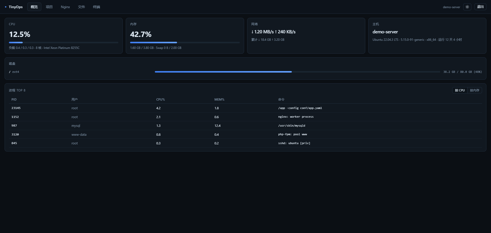
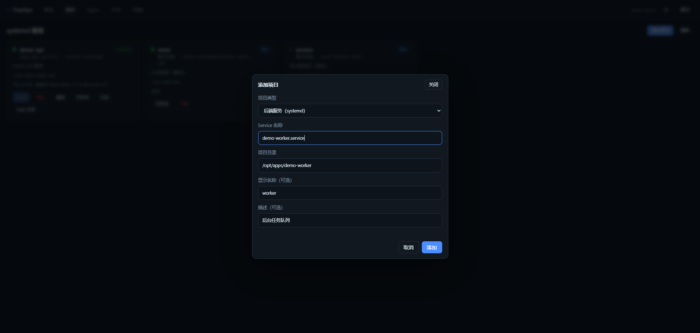
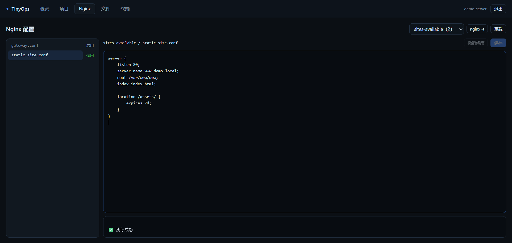
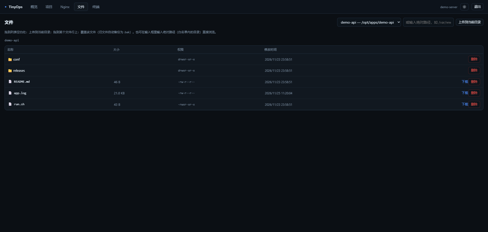
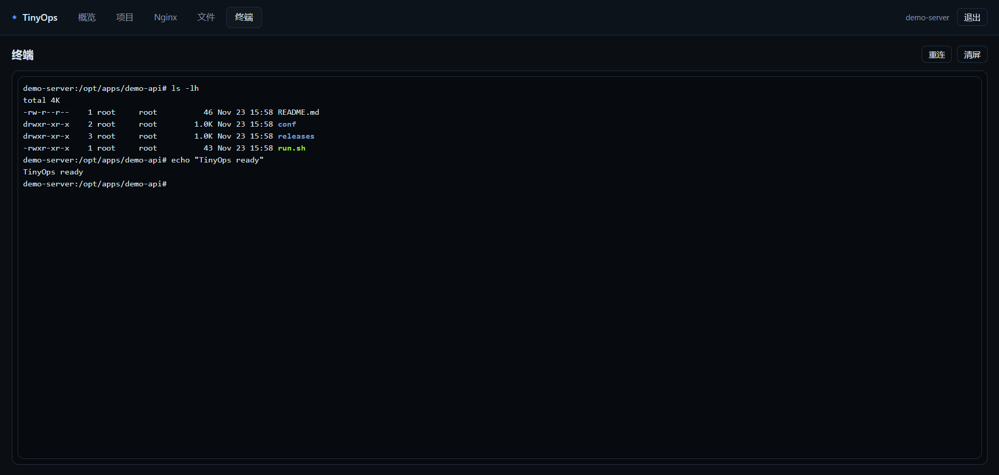
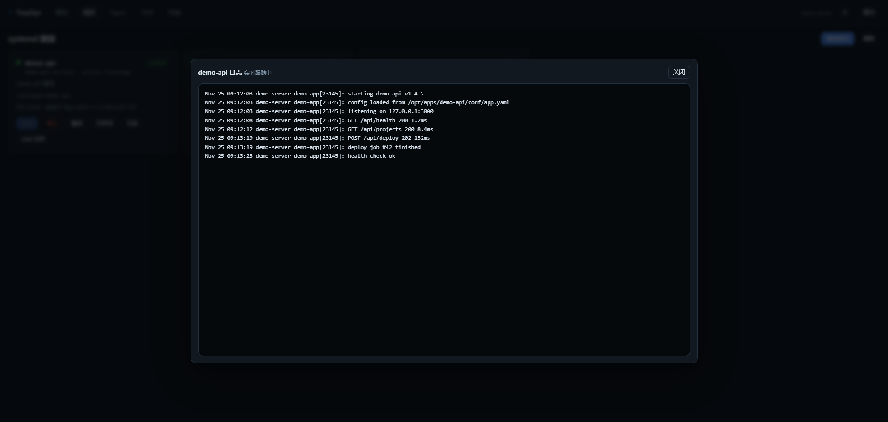

# TinyOps - 简单到极致的服务器运维面板

简单到极致的 Linux 服务器运维面板：管 systemd 项目、静态站点、Nginx 配置、机器状态、文件和终端。

前端（含 xterm.js）用 `go:embed` 打进二进制，部署时只需要一个可执行文件和一份配置。

## 功能

- 概览：CPU、内存、磁盘、网络、负载、Top 进程（可按 CPU / 内存排序），2 秒刷新，直接读 `/proc`
- 项目：自动发现 `/etc/systemd/system` 下的自建 service，启停、重启、实时日志、跳到项目目录、查看/编辑 unit 文件
- 静态项目：目录根部有 `index.html` 的纯前端项目，关联 nginx 站点后可上线/下线
- 添加项目：后端填 service 名和目录，静态项目填目录，按 `root` 自动匹配 nginx 配置
- Nginx：按分组浏览 `conf.d` / `sites-enabled` / `sites-available`，在线编辑、备份、`nginx -t`、重载、站点启停
- 文件：浏览项目目录或任意绝对路径，拖拽上传/覆盖、删除（密码确认），自动 `.bak` 备份并保留权限
- 终端：PTY 终端，vim、htop 这类交互程序可以用
- 登录：密码 + 会话 Cookie

## 截图

登录


概览



项目


添加项目



Nginx 配置



文件



终端



实时日志



## 连接

服务只监听 `127.0.0.1:4237`。本地执行：

```bash
ssh -N -L 4237:127.0.0.1:4237 ubuntu@your-server
```

浏览器打开 `http://127.0.0.1:4237`。

`-L` 把本机 4237 转发到服务器的 4237，链路走 SSH 加密。本机端口被占用时改成 `-L 18080:127.0.0.1:4237`。

## 安全

这个面板能执行命令、改配置、开 root 终端，所以只监听本机，不暴露公网。

- 通过 SSH 隧道访问，不需要额外配 HTTPS
- 密码登录，会话会过期，失败次数有限制
- 文件页可访问任意目录（等同 root 终端），Nginx 操作限制在配置目录内；覆盖前备份、删除需重新输入密码

如果要公网访问，至少加 HTTPS 反向代理、强密码和 IP 白名单，或者放进 VPN。

面板以 root 运行，部署后记得改掉 `change-me`。

## 部署

产品名是 TinyOps，二进制、systemd unit 和目录沿用 `projectmanager`，老部署不用迁移。

从 Releases 下载 `projectmanager-linux-amd64.tar.gz`，服务器上执行：

```bash
tar -xzf projectmanager-linux-amd64.tar.gz
cd projectmanager-deploy
sudo bash install.sh
```

首次安装会提示设置密码。非交互环境：

```bash
PM_PASSWORD=换成强密码 sudo bash install.sh
```

脚本会：

- 安装二进制，已有二进制先备份为 `.bak`
- 首次安装时创建配置和 systemd unit，已存在的配置、unit 保持不动
- 已有 unit 时，从 `ExecStart` 解析实际的二进制和配置路径，兼容自定义部署目录
- 启动失败自动回滚旧二进制
- 启动后请求 `/api/me` 做一次健康检查

### 版本更新

不用先手动停服务，脚本里会 `systemctl restart`，等于停+启。重复上面的部署步骤即可：

```bash
tar -xzf projectmanager-linux-amd64.tar.gz
cd projectmanager-deploy
sudo bash install.sh
```

更新时，现有的配置、systemd unit 和 `projects.added.json` 都保持不动；旧二进制备份为 `.bak`，重启失败自动回滚。重启期间有几秒中断，更新后建议检查：

```bash
systemctl status projectmanager --no-pager
journalctl -u projectmanager -n 50 --no-pager
```

打发布包：

```bash
bash scripts/package.sh
# 输出 dist/projectmanager-linux-amd64.tar.gz
```

## 配置

默认读工作目录下的 `config.yaml`，生产用 `/etc/projectmanager/config.yaml`。

```yaml
listen: "127.0.0.1:4237"

password: "change-me"        # 建议改用环境变量 PM_PASSWORD
session_hours: 24
max_upload_mb: 512

systemctl: ""                # 留空自动查找

discover_projects: true      # 扫描 /etc/systemd/system 下的自建 service
# discover_exclude:
#   - some-helper.service

nginx:
  config_dir: /etc/nginx
  binary: /usr/sbin/nginx
  service: nginx
  # 默认探测 conf.d / sites-enabled / sites-available
  # dirs:
  #   - name: conf.d
  #     path: /etc/nginx/conf.d

terminal:
  shell: /bin/bash
  home: /root

projects:
  - name: api
    desc: 主 API 服务
    unit: app-api.service
    dir: /opt/apps/api

  # - name: www
  #   type: static
  #   dir: /var/www/site
  #   site: sites-available/www.conf
```

- `PM_PASSWORD`、`PM_LISTEN` 优先于配置文件
- 项目来源：`config.yaml`、面板添加、自动发现
- 面板添加的项目写在配置同目录的 `projects.added.json`，不改 `config.yaml`
- 静态项目下线只动 nginx 配置，删软链或把 `conf.d` 文件改名 `.off`，不删真实文件

## 资源占用

Go 单进程，没有数据库。空闲内存 20-40 MB，CPU 接近 0，2 核 2G 够用。主要开销是每 2 秒采样一次，以及打开页面时的轮询、日志和终端会话。

```bash
systemctl status projectmanager --no-pager | grep -E 'Memory|CPU'
PID=$(systemctl show -p MainPID --value projectmanager)
ps -o pid,rss,%cpu,etime,cmd -p $PID
```

## 使用提示

- 静态项目目录根部必须有 `index.html`，否则添加失败
- nginx 自动匹配看配置里的 `root` / `alias`，匹配不到或有多个时手动填 `分组/文件`
- Nginx 保存后会自动 `nginx -t`，通过后再点重载
- 拖到文件列表空白处上传到当前目录，拖到某一行上覆盖该文件
- 文件页可输入绝对路径浏览任意目录
- 删除文件/空目录需重新输入登录密码确认，非空目录需先清空或用终端删
- 项目卡片「Unit 文件」可查看/编辑 unit，保存后自动 `systemctl daemon-reload`
- 以 root 运行时，覆盖会保留原属主，新建文件继承父目录属主
